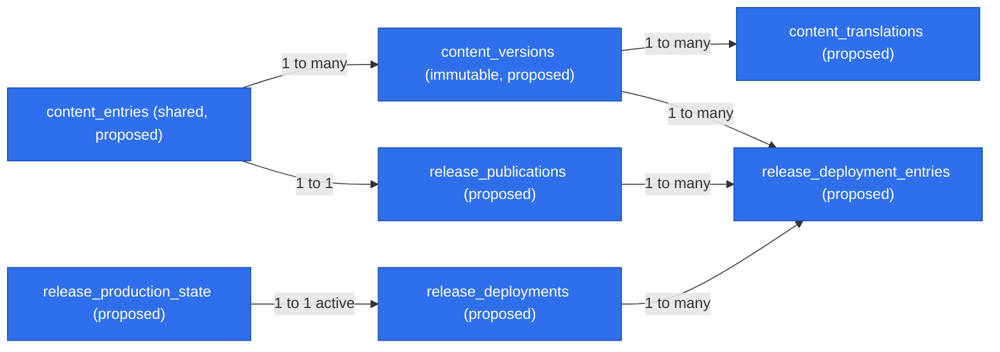

# Release history in Settings

| Field              | Value |
| ------------------ | ----- |
| **Status**         | ready |
| **Issue**          | #1730 |
| **Spec PR**        | none  |
| **Implementation** | none  |

<!-- agent-brief-sha256: fee214748683182aaac90944d9575214c57eb44f2596198ec8de19ebe5472fcb -->

## TLDR

Travellers will open **Release history** in Settings and read what improved, when it
shipped and which release contains it. Reviewed English prose in `CHANGELOG.md` will
remain authoritative; D1 will hold its immutable derived content and publication evidence.
Only releases proven deployed to production will appear. This issue delivers design only:
no runtime, migration, workflow, credential or guard changes are authorized by this spec PR.
A person merges it; implementation tickets require fresh security and tenancy review.

## Problem and verified baseline

At authoring HEAD, `src/routes/_app/-ui/settings-nav.tsx` has seven sections and no
release history. Searches for `content_entries`, `content_versions`, `content_translations`
and release-history modules across `src/`, `e2e/`, `.ai/specs/` and `docs/adr/` found no
implemented shared content store or covering release-history spec.

`CHANGELOG.md`, SDLC's release rules, ADR 0003 and the repo-local
`om-auto-update-changelog` override already define versioning, a human-written Highlights
paragraph and a `develop` to `main` promotion. The first release heading and its date also
bound housekeeping. `scripts/agents/close-fixed-issues.mjs` is the current reconciler;
its repo-local skill supersedes the generic skill's closure algorithm.

The existing production workflow checks credentials, migrates, deploys and smoke-checks
tiles. A workflow can finish successfully with deployment skipped for absent credentials.
Its generic tile check proves neither the served commit nor the Cloudflare version.
Neither a green run alone nor a promotion merge is publication evidence.

## Scope and reconciliation with Content Studio

One capability owns collection, review, deployment reconciliation and reading of release
history. An empty Settings page alone does not deliver that capability. Blog, help, RSS,
announcements, full Studio editing, a new version policy and automatic main promotion are
excluded. No dependency is added.

The [Content Studio plan](../../docs/plans/13-content-studio.md), 13-S2/13-S8, remains the
shared content direction. Reuse its `content_entries`, immutable `content_versions` and
`content_translations`; release entries belong to `collection=blog`, `category=changelog`.
Do not add a second release-prose table, Markdown editor or parallel translation resolver.
Release deployment metadata is a separate relation to a shared content version, not a
competing content store. The early slice implements only these shared primitives and a
headless import/review path. Later Studio work extends them in place. Its changelog editor
must link to the Git source and import new Git revisions; it must not edit imported English
release content independently. Generic `publishVersion`, `rollbackToVersion`, deletion and
snapshot writers must refuse changelog entries unless they use the same release-eligibility
and withdrawal rules; no generic content pointer can bypass deployment evidence. Release
history and receipt relations cannot be cascade-deleted by an ordinary content deletion.

13-S2's KV snapshots are for anonymous marketing routes. Settings is authenticated and
reads a narrow published D1 projection, so it needs no KV write, cache or TTL. A later public
blog projects the same eligible versions through the planned snapshot builder, with its own
visibility/retraction tests. This design does not change the anonymous zero-D1 promise.
The plan's `editor`, `publisher` and `platform_admin` roles are proposals, not the current
`user | curator | admin` contract. The early slice uses existing platform `admin` only.

### Alternatives and external design check

D1 as editorial authority would require a Studio-to-Git export and approval cycle before
promotion and would move an existing release contract. Waiting for the entire Studio adds
unrelated prerequisites. Git authority plus shared derived storage is the smaller complete
slice, chosen by an independent architect.

[Keep a Changelog](https://keepachangelog.com/en/1.1.0/) was fetched on 2026-11-03:
its human-readable grouped changes, newest-first versions and separate unreleased section
support this reading surface. Preserve this repository's heading format rather than adopt
its sample syntax. [GitHub deployment status documentation](https://docs.github.com/en/rest/deployments/statuses)
was also checked: deployments accumulate statuses, including inactive and failed states.
A status event is a reconciliation trigger, not a trusted instruction to publish. No provider
API payload or guarantee is assumed from that documentation; the implementation must
capture a real, redacted correlated deployment sample before relying on provider fields.

## Authority and release identity

- The existing `# X.Y.Z (YYYY-MM-DD)` heading remains byte-format compatible. Keep minor
  for feature promotions, patch for fixes/internal work, and the existing major policy.
  Do not add a package version or release tags.
- Release identity is the unique `(production, headingVersion)` pair. Store heading date
  separately from `firstShippedAt`, which is the first verified production deployment time.
  Display the latter as the release date; do not rewrite housekeeping dates to match it.
- `VITE_SENTRY_RELEASE` remains a commit SHA; Cloudflare's deployment/version id remains a
  provider identifier. Neither is a user-facing release version. Settings exposes neither.
- Git owns English text, heading date, version and enumeration cutoff. An imported revision
  records the exact source commit, normalized content hash and cutoff SHA. D1 cannot edit
  those fields. Translations and editorial approvals attach to that exact content revision.
- Draft collection stays in the existing changelog-preparation PR process. Do not insert an
  `Unreleased` heading above the version of record or advance a dated heading casually.
  Before a new heading merges, reconcile the outgoing housekeeping window with an explicit
  start/adequate limit and retain the existing promotion-head cutoff recheck. The notes PR
  itself may be excluded as documentation, explicitly; every other newly added merge must
  be enumerated or explained before approval.
- A heading merged into `develop` can be the version of record before production ships it.
  This existing repository meaning does not grant D1 shipped visibility. There is no
  bidirectional Git/D1 sync and no automatic Git commit from a publisher.

## Architecture and ownership

| Owner, proposed unless marked existing            | Responsibility                                                                                                                               |
| ------------------------------------------------- | -------------------------------------------------------------------------------------------------------------------------------------------- |
| `src/server/content/releases.ts`                  | Pure release state rules and reconciliation orchestration; dependencies supply Git/deployment evidence and storage; no SQL or Worker binding |
| `src/server/content/collections.ts`, `resolve.ts` | Shared blog/changelog schema and sole editorial-locale resolver, compatible with 13-S2                                                       |
| `src/server/repos/content.ts`                     | Shared immutable content persistence and platform authorization, admitted only by the amendment below                                        |
| `src/server/repos/releases.ts`                    | Release identity, approvals, receipts, atomic pointer transitions and narrow published listing                                               |
| `src/server/fns/releases.ts`                      | Zod-validated authenticated Settings read; never calls another server function                                                               |
| `scripts/releases/sync.mts`                       | Operator entry point for preview, import, approval and reconcile; transport uses the authorized server path, no raw SQL                      |
| `src/routes/_app/settings/releases.tsx`           | Settings route calling the read function; rendering in a route-adjacent `-ui` module                                                         |
| Existing SettingsNav/SettingsSection              | Add one navigation entry and reuse the settings frame                                                                                        |
| Existing production deployment owner              | Supply verified production receipts after deploy and identity check; future workflow change reviewed separately                              |

No SQL in routes, scripts, `content/` orchestration or `components/ui`. New repository
methods have cross-workspace negative tests even where the intentional result is the same
published platform content for A and B. A caller cannot pass an organization id to select
an alternate content source. No faux tenant or workspace grants platform rights.

## Data Model

All following entities are proposed, additive, generated via `pnpm db:generate`. Use
existing id and timestamp conventions; do not pre-create unrelated Studio tables.

| Entity                       | Fields and constraints that matter                                                                                                                                                                                                                                 |
| ---------------------------- | ------------------------------------------------------------------------------------------------------------------------------------------------------------------------------------------------------------------------------------------------------------------ |
| `content_entries`            | Shared id; unique `(collection, slug)`; blog category `changelog`; lifecycle status; approved published-version pointer. No organization id.                                                                                                                       |
| `content_versions`           | Immutable entry revision; unique `(entryId, revision)`; bounded typed title/summary/feature/fix blocks; English source; source commit, hash and cutoff metadata. No raw HTML.                                                                                      |
| `content_translations`       | Unique `(versionId, locale)`; translated typed body and explicit reviewer/time; never reused for a different source revision.                                                                                                                                      |
| `release_publications`       | Unique `(environment, releaseVersion)`; entry id; heading date; approved source-version id/hash and reviewer/time; visible-version pointer; first shipped time; withdrawn time/reason enum; CAS generation. `environment` restricted to production for this slice. |
| `release_deployments`        | Unique provider deployment/version identity plus run/attempt; exact main commit, source-tree identity, verified production target and activation time; verified outcome; retained receipt digest. No credentials, raw logs or request payload.                     |
| `release_deployment_entries` | Unique `(deploymentId, publicationId)`; exact source-version id contained in that deployment, allowing one deployment to prove several historical entries without copying prose.                                                                                   |
| `release_production_state`   | Singleton active deployment pointer and generation; stale evidence cannot replace it.                                                                                                                                                                              |

A source edit appends a version, invalidates approvals for the new revision and leaves the
old publication visible until a verified replacement is ready. Version reuse with a different
cutoff or release identity is refused, not silently overwritten. Audit records use the existing
`platform_audit_log`; audit metadata contains ids, hashes, outcomes and reason codes, not prose.

The deployment-to-entry relation proves exactly which immutable prose revision shipped;
entries and translations remain reusable shared Content Studio data.

### Explicit contract amendment required before implementation

This paragraph is a proposed amendment, not permission to bypass today's closed contract.
The first implementation slice must land an ADR and matching edits to SPEC §§5/6/9,
`docs/ARCHITECTURE.md`, `docs/ACCESS.md`, `CODE_REVIEW.md`, AGENTS and all duplicate policy
statements found by grep. No runtime content SQL may precede that amendment.

Admit exactly the seven tables above as application-wide content, with SQL only in the two
named `server/repos` modules taking a `Database`, not a `TenantScope`. This is a new bounded
content repository exception, not another catalogue discovery member, FU-3 resolver or
permission for arbitrary global queries. Published reads whitelist approved non-withdrawn
release fields only; no draft, reviewer, deployment coordinates, arbitrary collection or tenant
join is selectable. All writes require the fresh existing platform permission guard and an
audit row in the same atomic database batch. Extend the existing permission vocabulary with
`release:review` and `release:publish`, granted only to platform `admin`; curator, user and
all workspace roles are denied. Re-read role/ban state before invoking the existing pure
`requirePermission`; do not replace it with a second role resolver. Impersonation is denied.

SPEC §9 also needs a bounded editorial-content exception: release prose is reviewed content,
separate from interface messages, with the fallback policy below. Until that amendment lands,
English fallback on this signed-in surface would violate §9 rules 2/6/8. Future Studio roles,
additional collections/tables and anonymous publication remain separate amendments.

## Collection, approval and publication lifecycle

1. **Collect/import.** The changelog preparation PR contains original benefit-focused English
   descriptions and existing contributor attribution/cutoff information. Import previews a
   diff, validates the restricted release-body grammar, then appends the exact Git revision
   into shared content versions. Historical markdown outside the supported grammar fails
   with a location and no partial write; a reviewed Git correction or explicit migration is
   required. Never silently discard a paragraph or interpret raw commit messages as notes.
2. **Editorial review.** A platform admin approves a named source hash after checking plain
   language, accuracy, safe links, privacy and sensitive security details. Approval is distinct
   from deployment and does not make a release visible. New source hashes or translations
   require new review. Review is an operator action, never generated from an issue body.
3. **Promote.** A person merges the guarded promotion with a merge commit. Preserve
   `do-not-merge`, the main ruleset, current CI gates and manual Highlights authorship.
4. **Verify deployment.** The adapter re-fetches trusted deployment records, verifies repository,
   production Worker/target, exact main commit/tree, successful actual deploy and subsequent
   served identity. Require correlation of served commit and `CF_VERSION_METADATA` version
   with the receipt, not a plain HTTP 200/206. A future minimal identity response must expose
   only artifact ids, no environment secrets, and be separately reviewed/tested. Staging,
   preview, skipped credentials, cancelled/failed deploy, pending status, inaccessible evidence,
   forged receipt or mismatch leaves notes approved but unshipped. Evidence is supplied as
   dependencies to the state module; the browser cannot submit or override it.
5. **Reconcile/publish.** Verify the exact deployed Git tree contains the approved source hash
   and cutoff; containment in ancestry alone is insufficient if a later commit changed it.
   Record the receipt and entry links and CAS publication pointers with their audit rows in
   an atomic `runBatch`. No interactive D1 transaction or cross-system atomicity is assumed.
   Re-read active production identity immediately before committing; ambiguous or changing
   activation leaves the operation pending for retry. A late older receipt can record history
   only after independently verifying it truly ran; it cannot replace the active pointer.

`sync` defaults to preview. Separate explicit import, approve and reconcile operations name
source version/hash; an apply operation cannot imply approval or promote main. The initial
slice uses an authenticated platform-admin operator, not a tenant token, unauthenticated webhook
or newly empowered agent. Automated receipt collection may be read-only; automatic production
writes require their own reviewed authorization and are not assumed approved here.

### Recovery, ordering and rollback

- Uniqueness makes repeated identical import/reconcile a no-op with the same result. A conflicting
  identity/hash returns a conflict and preserves all previous versions. Read state after a lost
  response before retrying; retry uses the same operation identity and expected generation.
- D1 receipt/pointer/audit failure rolls back that batch; Git, notes and previous visible pointer
  survive. Failure after deployment cannot roll production back implicitly. Fix the sync and
  reconcile the already deployed immutable revision. Failure after commit but before response
  is resolved by reading the receipt/result. No dependence on a transient queue marker.
- Active-state ordering comes from re-verified provider activation identity and CAS, not webhook
  arrival, semver comparison or untrusted event timestamps. If evidence cannot order two
  activations, publish neither new active pointer until the adapter resolves current state.
- History lists by `firstShippedAt DESC, releaseVersion DESC` using deterministic binary
  comparison for ties. Pagination uses that same tuple. No optimistic UI release insertion.
- A production rollback updates active deployment evidence; already shipped entries remain
  historical facts, with their original shipped dates. The screen never labels the top row as
  “currently deployed.” A later redeploy does not duplicate the row or reset its date.
- A harmful or sensitive note can be withdrawn by an audited platform-admin action. It disappears
  from all published projections; immutable source, receipt and audit history remain restricted.
  A stale publication retry cannot undo withdrawal. Restoration requires a new explicit review
  and generation. Git corrections must also remove unsafe prose through the ordinary reviewed
  process; D1 withdrawal is not represented as erasing public Git history.
- Corrections to a shipped entry are append-only Git/D1 revisions. Switch the visible pointer
  only after the correction itself is approved and included in a verified production artifact.
  Preserve `firstShippedAt`; the new body displays its last updated date. A deployment rollback
  may retain previously shipped corrected prose: release history is not the active bundle's
  documentation. Never restore withdrawn sensitive text automatically.
- Historical backfill needs real deployment evidence per release. A heading date or merged PR
  is not proof; unprovable historical entries stay absent. Empty history is an honest outcome.

## API Contracts and trust boundaries

The proposed `listReleaseHistory({ locale, cursor?, limit? })` GET server function requires a
valid app session and Zod input. Locale is the existing 23-tag enum; opaque cursor is validated
against the sort tuple, limit defaults to 20 and is bounded 1-50. Derive identity from session;
accept no organization, status, collection, publication flag or platform role from the client.
Any later input addition is optional for one release, per BACKWARD_COMPATIBILITY.

Return `{ items, nextCursor }`; each item has only `{ version, shippedAt, updatedAt?,
contentLocale, sourceLocale, usedFallback, title, summary, features, fixes }`. Lists contain
bounded plain-text/typed safe-inline content only. Dates are epoch milliseconds on the wire.
Unknown locale/cursor is a validation refusal; storage failure is an error, not an empty list.
No source SHA, receipt, internal PR link, reviewer, audit field or draft status is returned.

Headless mutations validate explicit operation kind, expected generation, release version and
source hash with Zod, assert fresh platform authorization in the repository, and return
`applied | unchanged | conflict | pending-evidence | refused` with a stable operation id.
They re-read persisted state after uncertain transport outcomes. Transport and error mapping
must use the existing server-function/auth conventions; no stack or raw vendor response goes
to the browser. There is no public publication endpoint in this slice.

## Content locale and safe rendering

English is the source locale. Reviewed translations are keyed to the immutable source version.
For a missing/unreviewed/stale translation, render the entire entry in English, including its
heading and body, set `lang="en"` and appropriate direction on that entry, and show a catalogue
notice in the reader's language. Do not mix translated paragraphs from an older revision with a
new English summary. `content/resolve.ts` owns this choice for Settings and future Studio
consumers; interface translation has no fallback. Adding a translation does not alter shippedAt
or require a new application release, but review and audit are mandatory before visibility.

Render typed blocks through React, never raw HTML, arbitrary markdown or `dangerouslySetInnerHTML`.
The release subset supports paragraphs and feature/fix lists; links, if retained from source,
allow only validated HTTPS or internal paths, with an explicit safe rendering rule and tests.
Reject scripts, event handlers, unsafe protocols, remote embeds and arbitrary image markup.
Review excludes secrets, customer/workspace identifiers, tenant content, exploit details and
unreleased security information. Internal attribution/cutoff metadata stays outside the display
projection; it is not automatically rendered as user prose.

## UI/UX

Add `/settings/releases` after Billing in SettingsNav, reusing SettingsSection, Card, existing
text tokens and date formatters. Each release is an article headed by localized version text,
with `<time datetime>` for its production date, a short benefit summary and feature/fix groups
only when nonempty. No search, filters, unread badge or announcement popup. Load 20 entries
initially; an explicit “Show older releases” button appends the next page and retains focus.

Pending route: reserved skeleton geometry and a polite localized loading announcement. Empty:
explain that no published release notes exist; do not show drafts. Error: localized explanation
and Retry, preserving already loaded entries during pagination failure. Retry re-reads state,
never publishes or changes preferences. After retry removes its focused error button, focus the
section heading; after page append retain the pagination control, or focus the appended first
article heading when the final control disappears. Announce appended count through the existing
i18n plural mechanism. Route navigation follows the existing Settings focus pattern.

At 360px use the current horizontal settings navigation, wrapped version/date text and one
column. At desktop use the existing sidebar and readable prose width. Use logical spacing for
Arabic, light/dark tokens, visible keyboard focus and no status conveyed only by colour.
Maintain heading hierarchy and one page h1, AA contrast and reduced-motion support. Dates use
the repository's deterministic locale formatting with hydration parity, not ad hoc Intl output.
Reserve loading space and measure shifts within this section, not unrelated shell changes.

## Visual change expected

Implementation will add the Settings navigation item and release cards, plus pending, empty,
initial error, pagination error, fallback notice and updated-date states on `/settings/releases`.
Verify light/dark at 360px, 1280px and 2560px, keyboard and Arabic RTL; attach the repository's
blind A/B evidence pair. This design-only PR changes no rendered route and needs no screenshots.

## Copy

Proposed English interface messages below land in `messages/en/settings.ts` and all other
22 locale catalogues in the UI slice, following `i18n-messages`. Reuse existing suitable keys
for Retry/loading where available rather than add duplicates. Release titles and descriptions
are editorial content with the separate amended contract above.

| Key                              | English                                                              |
| -------------------------------- | -------------------------------------------------------------------- |
| `settings.nav.releases`          | Release history                                                      |
| `settings.nav.releases.hint`     | See what has improved                                                |
| `settings.releases.title`        | Release history                                                      |
| `settings.releases.description`  | Improvements and fixes shipped in planned.travel.                    |
| `settings.releases.version`      | Version {version}                                                    |
| `settings.releases.shipped`      | Released {date}                                                      |
| `settings.releases.updated`      | Notes updated {date}                                                 |
| `settings.releases.features`     | Improvements                                                         |
| `settings.releases.fixes`        | Fixes                                                                |
| `settings.releases.empty.title`  | No release notes yet                                                 |
| `settings.releases.empty.body`   | Published improvements and fixes will appear here.                   |
| `settings.releases.error`        | Release history could not be loaded. Try again.                      |
| `settings.releases.olderError`   | Older releases could not be loaded. Your current list is still here. |
| `settings.releases.retry`        | Retry                                                                |
| `settings.releases.loading`      | Loading release history…                                             |
| `settings.releases.older`        | Show older releases                                                  |
| `settings.releases.fallback`     | These notes are available in English.                                |
| `settings.releases.loaded.one`   | {count} older release loaded.                                        |
| `settings.releases.loaded.other` | {count} older releases loaded.                                       |

Use the catalogue's actual plural representation, including every form required by each locale;
the final two rows describe messages, not permission to invent another plural API.

## Acceptance examples and verification

Test rules through the publication module interface with local substitutable storage and fake
Git/deployment dependencies. Do not test only a mock's own returned ordering. Runtime work is
test-first: demonstrate each regression failing before adding its implementation.

| Example                                                                              | Expected evidence                                                                                           |
| ------------------------------------------------------------------------------------ | ----------------------------------------------------------------------------------------------------------- |
| Approved 0.2.0 on staging, promotion merged, or credential-skipped green workflow    | No new shipped entry                                                                                        |
| Successful production receipt but mismatched served SHA/version or source hash       | Pending/refused; prior history preserved                                                                    |
| Verified production artifact containing approved 0.2.0 source                        | One visible entry; correct production date and safe projection                                              |
| Repeat import, repeat receipt, concurrent publication and lost response              | Same result; one identity, receipt relation and transition audit; no lost revision                          |
| Deploy B active, delayed A event arrives                                             | A cannot replace active B; historical proof checked independently                                           |
| Batch fails at receipt, pointer or audit write                                       | None of that transition commits; retry after recovery succeeds                                              |
| 0.2.0 and 0.3.0 have equal shipped timestamps                                        | Stable binary tie order and no duplicate/gap across cursor pages                                            |
| Corrected English revision, translation still targets old version                    | Old published revision remains until correction ships; then whole entry falls back to English               |
| Owner/admin of workspace A or B, platform user/curator, banned or impersonated admin | Publishing refused; no draft or tenant payload; valid readers share only identical approved platform fields |
| Rollback B to A, duplicate rollback event, redeploy B                                | Historical dates unchanged; active pointer correct; no duplicate entries                                    |
| Withdraw sensitive B notes, then retry stale publication                             | B stays invisible; restricted history and audit retained                                                    |
| Storage read fails, empty database, pagination fails then retries                    | Distinct error/empty states, current list preserved, named focus targets                                    |
| English, reviewed Polish, missing Polish, stale translation, Arabic UI               | Exact revision choice, visible localised fallback notice, entry lang/dir and hydration parity               |
| Unsafe source markup/link or oversized input                                         | Validation refusal before persistence; no executable output                                                 |

Use server tests for rules, repository integration tests for constraints/batch atomicity/CAS and
cross-workspace denial, tooling tests for source parsing/heading compatibility/evidence adapters,
and UI tests for states and focus. A browser journey opens Settings history with a real session
and seeded published/draft data, switches locales and retries a controlled failure. Restore
fixtures afterwards; do not call production. Restart the worktree dev server before browser
proof, as required by AGENTS. Full configured gate and appropriate critical journeys must pass
on each runtime slice; verify docs grep and generated artifacts are staged before that gate.

## Risks and compatibility

The hard boundary is trustworthy evidence after the exact production artifact actually serves.
An unavailable or ambiguous provider read delays notes rather than invents publication. The
implementation must supply a redacted real sample and pass security review before enabling any
production write. No claim of distributed atomicity or vendor transaction limit is made here.

Migrate additively before code deploy; old Workers ignore new tables. No existing server-function
contract changes, heading/cutoff reinterpretation, Sentry identity change or main guard weakening.
Feature rollback can remove the Settings entry and stop sync while retaining all data and audit.
Never drop the tables to disable the feature. This spec neither backfills unverifiable releases
nor claims merging it means the feature shipped.

## Resolved assumptions (autonomous defaults)

| #   | Question                           | Applied default                                                                                                                         | Why                                                                                                                                                            |
| --- | ---------------------------------- | --------------------------------------------------------------------------------------------------------------------------------------- | -------------------------------------------------------------------------------------------------------------------------------------------------------------- |
| 1   | Runtime or design now?             | Design-only ready spec; human merge, later sliced implementation                                                                        | Existing triage product-owner and security/tenancy approvals explicitly restrict #1730 to design; no new runtime authority.                                    |
| 2   | Content authority and scope split? | Git English authority; shared Content Studio storage, complete headless publishing and Settings slice; full Studio deferred             | Independent architect, high confidence: avoids competing authority and unrelated prerequisites; collection and reading share the shipped-visibility invariant. |
| 3   | Publication boundary and rollback? | Correlated successful production artifact evidence; immutable revisions/receipts; historical releases survive rollback, withdrawal wins | Independent architect, high confidence: generic smoke checks cannot prove identity, and delayed events must not change active production state.                |
| 4   | Roles and editorial language?      | Existing platform admin only; reviewed English fallback by explicit SPEC amendment                                                      | Architect conditions: the planned roles are not current authority; §9 currently forbids the proposed in-app editorial fallback.                                |

## Design review

An independent fresh-context reviewer approved scope cohesion and consistency with the
referenced architecture, auth guard and compatibility contracts. No blocking finding was
identified. This is a document review, not verification of a running implementation or of
provider evidence. The seven tables and exact-artifact evidence path still require the
implementation security/tenancy gates above.

## Phasing and Implementation Plan

These are implementation tickets after this design merges; the authoring PR applies none of
the listed changes. The sequence is serial where shared contracts are involved. Re-check the
Content Studio implementation and deployment machinery at each ticket's HEAD before creating
files, and extend an existing owner if another ticket has already delivered it.

### Phase 1 - Contract and shared data foundations, no exposed publication

1. Land the ADR and exact SPEC/access/architecture/policy amendments described above, including
   editorial fallback and bounded SQL access. Define source grammar and all seven table constraints,
   permission/audit vocabulary, deployment identity adapter and threat model. Fresh security and
   tenancy approval is a gate before runtime work. App behavior remains unchanged.
2. Test the shared repository interface first: immutable import/revisions, uniqueness, draft
   invisibility, cross-workspace/role denial and atomic audit. Implement only required shared
   Content Studio tables and release relations with generated additive migrations. Imports are
   preview/local-only until the separately authorized operational path lands. No Settings route yet.

### Phase 2 - Complete controlled publication capability

3. Test and implement the bounded changelog importer and explicit admin review/import/reconcile
   transport, with persisted operation results and preview default. Preserve heading/cutoff consumers
   and review every sibling changelog/housekeeping skill through grep. Add the recovery runbook to
   `docs/DEPLOY.md`: inspect result, re-fetch evidence, retry same operation, withdraw, disable sync.
4. Test first with failed/skipped/mismatched/duplicate/out-of-order receipts and lost responses;
   implement exact-artifact deployment evidence and CAS transitions through injected dependencies.
   Integrate the production receipt path only after fresh security/configuration review and explicit
   production-write authorization. Preserve all main promotion guards. Capture the real redacted
   evidence sample; exercise the complete import-review-publish-retry path in local/staging fixtures
   before enabling production. Missing authorization leaves sync disabled, not an invented bypass.

### Phase 3 - Settings delivery and end-to-end acceptance

5. Test listing projection/order/pagination, whole-entry locale resolution and every UI state/focus
   path before implementation. Add the Zod read function, Settings route/nav, all 23 catalogues and
   generated route tree; update enumerated settings routes/tests found by grep. Add glossary terms
   if implementation introduces further domain concepts. No data fetch in `components/ui`.
6. Run the table's integration scenarios, the real-session Settings browser journey and visual
   evidence across required viewports/themes/RTL. Verify rollback and withdrawal against local
   deployment fakes, full gate, docs grep and a security/tenancy review of the final runtime diff.
   Delivery is complete only when controlled publication and Settings work together; later public
   blog/Studio work reuses these stores without a second content authority.
