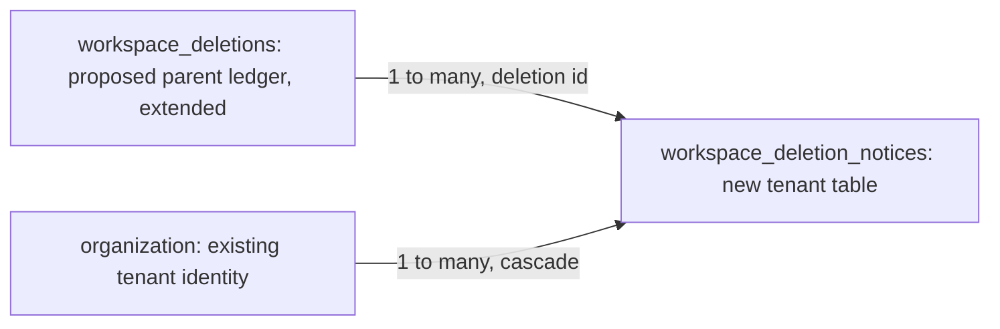

# Delete a team workspace after a cancellable notice window

| Field              | Value |
| ------------------ | ----- |
| **Status**         | ready |
| **Issue**          | #1744 |
| **Spec PR**        | #1818 |
| **Implementation** | none  |

<!-- agent-brief-sha256: 2a781f2d54cef3f42cd82fbb6fb9820d6f0d74d9148734fa31e64b5ec5d051f3 -->

## TLDR

Design only: a current workspace owner may schedule deletion of a workspace that still has other members. Every member receives notice, a full fourteen-day window follows, and any current owner may cancel before execution wins its atomic claim. Execution reuses the single workspace deletion driver; this PR enables no deletion behavior.

## Problem and verified starting point

The parent is [Delete a workspace you own](2026-10-17-delete-a-workspace-you-own.md), implemented through epic #1736. It explicitly defers team deletion to this ticket. Removing members first is available after #1008, but is not this notice workflow.

Verified against develop after bounded cleanup #1739 (PR #1817):

- `src/server/repos/members.ts` owns `deleteWorkspace(scope, { departingUserId? })`. Both it and `drainWorkspace` require `assertRole(scope.ctx, 'workspace.delete', 'owner')`; administrators are refused. Its final statement atomically refuses any member other than `departingUserId`, and refuses `livePaidSubscription()`.
- The bounded cleanup preparation is implemented: `repos/members.ts` exposes `drainWorkspace`, and `storage/workspace-objects.ts` exposes `drainWorkspaceObjects`, each with a finite budget and resumable `drained` result. Their current guards preserve sole-member deletion. The parent driver `src/server/workspace-deletion/`, its ledger, owner request function and join fence remain **designed, not implemented**. This design depends on them landing and being verified before its producers ship; reuse the bounded drain interfaces with the exact scheduled-branch guard amendment below, never an alternative cascade or an unbounded completion helper.
- `src/server/repos/billing.ts` defines `livePaidSubscription`: a provider subscription in a blocking status whose `cancelAtPeriodEnd` is false. An already-ending subscription is not blocking under that predicate. Preserve that rule and the parent's provider reconciliation, without automatic cancellation or refunds in the schedule flow.
- ADR 0007 forbids showing a non-member even a count or aggregate of another person's private trip. Membership and ownership changes already have atomic guards in `repos/members.ts`; the new schedule must compose with them, including multi-token stored owner roles.

The statement “existing deletion driver” in the brief therefore identifies a future dependency, not deployed code. No new dependency package, credential, payment instruction or legal term is needed for this document.

## Resolved assumptions (autonomous defaults)

| #   | Question                                  | Applied default                                                                                                                                                                                 | Why                                                                                                                                                                                                                                                              |
| --- | ----------------------------------------- | ----------------------------------------------------------------------------------------------------------------------------------------------------------------------------------------------- | ---------------------------------------------------------------------------------------------------------------------------------------------------------------------------------------------------------------------------------------------------------------- |
| 1   | May unattended work proceed?              | Approve design only; runtime work waits for the parent infrastructure.                                                                                                                          | Independent security and tenancy reviewer, high confidence, ESCALATE: no; all conditions below are acceptance criteria.                                                                                                                                          |
| 2   | How long and when does the clock start?   | Fourteen times 24 hours in UTC after all member notices are durable and all corresponding emails have been durably queued.                                                                      | Security reviewer chose fourteen days; product reviewer chose seven. The longer reversible window protects absent members without adding machinery. Queue acceptance is explicitly not delivery or reading.                                                      |
| 3   | Who cancels, and what invalidates notice? | Any current non-impersonated owner; automatically cancel on any effective membership removal or role change before execution. Block additions and invitation creation/acceptance while pending. | Security requires the join fence and cancellation when the requesting owner loses authority; product reviewer requires cancellation on membership/ownership change. The combined rule is more conservative and preserves departures. No-op writes do not cancel. |
| 4   | Notice failures and billing uncertainty?  | Retry while cancellable; never start destruction on incomplete notices or uncertain billing. A newly blocking subscription cancels the schedule.                                                | Both reviewers require fail-closed execution. Durable queued emails follow the security review's minimum and the existing queue boundary; provider receipt is not a reliable proof of human notice.                                                              |
| 5   | Separate capabilities?                    | One scheduled team-deletion capability with bounded enabling slices.                                                                                                                            | Scheduling without cancellation or safe execution is incomplete; no export, account-erasure or billing feature is bundled.                                                                                                                                       |

There are no unresolved implementation policy questions. Retention and money rules inherit the parent; no new legal promise of email receipt, export completeness or refund is made.

## Workflow and authorization

1. On `/settings/organization`, a current owner sees “Schedule workspace deletion”. The confirmation names the workspace and warns that all content, including content only other members can see, will be permanently removed. It offers existing Trip export, only through the reader's current access. It never offers an inventory of hidden trips or files.
2. Scheduling requires the parent's typed workspace name, fresh password/passkey step-up, rate limit, expected organization id and non-impersonated session. Resolve the target from `TenantScope`; the expected id is only a precondition. Bind the current owner membership into the insert/conditional write, not just the opening read. An admin, stale owner, foreign tenant or impersonated session changes nothing.
3. Insert one live deletion generation in `notifying`. Repeated requests with the same client request id return that generation; another request while one is live returns its current status. The client request id is an idempotency key, never authority. A cancelled attempt needs a new key and a new generation to reschedule.
4. Fence new members, invitation creation/acceptance, checkout and plan-changing writes immediately in `notifying`, throughout `scheduled`, and throughout execution. Cancellation lifts these fences. Billing webhooks remain processable and can invalidate the schedule. A join racing the schedule must either commit first and be included in its audience, or be refused. Hooks that merely read before Better Auth writes are insufficient: enforce the fence in the actual membership/invitation mutation through the repository/adapter boundary. Existing invitations remain valid after cancellation; revoke them only when irreversible execution begins, as in the parent path.
5. Page through the stable current membership audience. Persist one in-app notice per member and enqueue its email with a stable per-generation/per-user delivery identity. Queue failure leaves the notice unacknowledged and retries it; a crash after enqueue may duplicate a message but cannot silently omit a member. The retry worker only marks progress for the same live generation. No future worker may treat enqueue acceptance as email delivery.
6. Once every current member has the two durable records, atomically move `notifying` to `scheduled`, setting `due_at = database_now + 1209600 seconds`. Partial progress, retries, duplicate workers and reloads never start or shorten that period. Persist deadline-confirmation notices for the same audience; initial notices say the deadline is being prepared. In-app state is authoritative if a confirmation email arrives late or fails.
7. Normal reads, edits and authorized Trip exports remain available. A member may leave and an authorized actor may remove members or change roles; each actual change atomically cancels a pending schedule in the same D1 batch as that mutation. This covers Better Auth, repository methods, console/account erasure and ownership transfers, not only the settings UI. Keep existing last-owner protections. If execution claimed first, the mutation is refused by the execution fence instead. An existing member promoted to owner can cancel; that promotion has already cancelled the old schedule. Becoming sole-member never accelerates deletion.
8. Any current owner may cancel `notifying` or `scheduled`, without typing the name or performing another step-up. Require a current non-impersonated session and atomically verify its live owner membership. A stale requesting owner has no special permission. Cancellation records actor/reason, clears the join/billing fence, keeps all tenant data and queues cancellation notices to remaining members. Notification failures retry but never undo cancellation.
9. At or after `due_at`, the parent cron/queue driver verifies current owner authority for the requester, complete audience, the exact generation and billing. A provider read failure postpones execution with a reason code and cancellation still available. A blocking subscription cancels rather than silently rescheduling. A missing requesting owner or an audience mismatch detected here also conditionally cancels the still-cancellable generation, even if an earlier mutation handler was bypassed; it must not leave an ineligible schedule polling forever. No automatic cancel, refund or accelerated paid-period termination is introduced.
10. One conditional update changes `scheduled` to the parent's `requested`, records `execution_started_at` and the execution generation, and claims the driver's lease. Its WHERE includes the due time, notice completeness, current requester ownership and current non-blocking billing mirror. Cancellation and this update compete on the same state: cancellation committed first prevents execution; execution committed first makes cancellation explicitly too late. No trip drain, room closure, invitation deletion or cascade happens before this update.
11. Thereafter the same driver drains, cascades, audits, recovers sessions and sweeps storage twice as the parent specifies. Retries keep the same generation and irreversible execution state; a lost lease cannot reset the schedule or make it cancellable again. Recheck billing before every destructive step, as in the parent. An external billing change discovered after partial destruction cannot restore data: stop further destructive work, expose an execution failure to owners and keep the current execution state with `last_error` and a paused/retry classification. Never move a generation with `execution_started_at` to `refused` or `cancelled`: its execution fence and uniqueness remain live, it is never retention-pruned, and operator recovery resumes that same generation.

## State and data model

Extend the parent's **proposed** `workspace_deletions` ledger additively. Do not introduce a second deletion ledger or another cascade. Additional states are `notifying`, `scheduled`, `cancelled`; the existing states from `requested` onward remain the execution states. Add nullable schedule fields: `schedule_request_id`, `notice_started_at`, `due_at`, `execution_started_at`, `cancelled_at`, `cancelled_by_user_id`, `cancel_reason`. The ledger id is the generation. The existing requester identity binds the initiating owner. Immediate/erasure rows leave these fields null.

The parent's partial uniqueness predicate must exclude `cancelled` as well as `refused`; the shared pending/fence predicate must also exclude both terminal states. Pin every consumer, including cron discovery and retention. Never use `state <> 'refused'` as the revised predicate. Rows in `notifying` or `scheduled` must never enter the parent's drain merely because they are stale. Cron discovers incomplete notice work and due schedules separately, keyset-paged and bounded; it calls the same driver directly so a dead-lettered queue hop is not the sole recovery mechanism. Reuse the parent's production quarter-hour sweep; execution is at or after the deadline, not a promise of exact-time execution. Staging retains its documented slower cron cadence.

Add `workspace_deletion_notices`, a tenant table accessed only through `src/server/repos/workspace-deletion-notices.ts`: organization id with the ordinary tenant cascade, deletion id, member user id, `email_queued_at`, `deadline_email_queued_at`, `cancellation_email_queued_at`, unique `(deletion_id, user_id)`. The row itself is the durable in-app notice. Do not store trip ids, counts, names, activity or email addresses here; the worker resolves the recipient through the tenant repository. No user foreign key silently cascades away proof of notice: account/membership deletion cancels the schedule atomically first. The deletion id relates to the surviving ledger, while notice rows cascade with the workspace.

The global ledger survives execution; per-member notice rows disappear with tenant content. Use database-time instants and bounded pages, never an unbounded array of user ids in a ledger or SQL binding list. `MAX_BOUND_PARAMETERS` in `repos/batch.ts` is 100: statement parameters, not audience size, bound each batch. Tests must use the existing harness's limit enforcement.

Notice rows are deleted on cancelled/refused terminal generations after 30 days through a tenant-scoped retention method, before the parent's terminal-ledger prune. In-progress rows are never pruned. Cancelled ledger rows use the same 30-day terminal retention; audit evidence uses the parent's 400 days. Clear temporary receipt details on cancellation. Queue/dead-letter retention remains the existing email residual, not a new archive. Cancellation notices to removed users are unnecessary; the remaining audience is notified. Cancelling does not remove accounts or change memberships itself.

## One owner per mechanism and precise guard amendment

| Mechanism                                          | Owner and reuse                                                                                                                                                                                             |
| -------------------------------------------------- | ----------------------------------------------------------------------------------------------------------------------------------------------------------------------------------------------------------- |
| Schedule state, deadline, execution claim, retries | Parent `server/workspace-deletion/` driver and `catalog/workspace-deletions.ts`; the global catalog amendment belongs to the parent's SPEC §5/§6 contract, with only ids/state discovery, no member content |
| Notice audience and delivery progress              | Tenant repository `repos/workspace-deletion-notices.ts`; email message union in `auth/email.ts`, rendering in `server/email`, delivery in `queue/handlers/email.ts`                                         |
| Membership/role changes and atomic cancellation    | `repos/members.ts`, composed through existing auth adapters and mutation handlers; no route-owned SQL                                                                                                       |
| Owner commands                                     | `server/fns/workspace-delete.ts` and its pure writes module from the parent; routes call these functions and they call repositories, never another server function                                          |
| Destruction                                        | Existing `repos/members.ts` `deleteWorkspace` plus the parent's bounded drain, room closure and storage sweeps                                                                                              |

The new shared predicate is `(existing sole-member/erasure authorization) OR (matching ledger id AND schedule_request_id IS NOT NULL AND execution_started_at IS NOT NULL AND due_at <= database_now AND ledger is in an execution state)`, always conjoined with the target tenant, the driver's current lease/step token and the existing billing predicate. Require the lease/step token in each destructive statement so an expired worker cannot race another owner of the step. The scheduled branch additionally requires the recorded complete notice audience at the execution claim; no mutable client assertion can supply that proof.

Apply that predicate in **every bounded drain statement and the final organization DELETE**, with the schedule authority read from D1. A new optional internal deletion-id argument merely selects a row to validate; it never means “ignore members”. Existing immediate and erasure callers retain their original predicate when it is absent. The parent owner-only request authorization with fresh step-up must land first; the existing owner-only primitives do not establish a scheduled generation or notice completeness. Do not widen account-erasure permissions to delete surviving colleagues' workspaces.

Before irreversible execution, a membership/role write and its automatic cancellation form one D1 batch with mutually consistent conditions. After execution starts all membership, ownership, invitations and checkout/plan-changing writes are fenced. The activation gate remains closed until every direct, auth-adapter, console and erasure path is covered and races are tested. Re-grep actual callers at implementation HEAD; the current parent spec's enumerated list is not an exhaustive future-call-site contract.

## API contracts and visible states

Add new Zod-validated commands beside the parent's functions; preserve old signatures and response fields:

- `scheduleWorkspaceDeletionFn`: expected organization id, typed name, step-up proof and request id; returns a discriminated status with deletion id, `notifying` or `scheduled`, nullable due time and stable reason code. All strings are bounded and validated using repository id/name/proof schemas. No arbitrary target id or member ids are accepted.
- `cancelWorkspaceDeletionFn`: expected organization id and deletion id; returns `cancelled`, `already-cancelled`, `too-late` or `stale-generation`. No current owner means forbidden, regardless of who requested it. An old generation never cancels a new one.
- The settings loader returns a whitelisted current schedule projection for current members: id, status, due time, whether this owner can cancel and a generic retry reason. It contains no audience email list, hidden trip count, file count, parent snapshot or requester activity. Non-members receive the existing not-found/forbidden behavior.

Lost responses require a current-state reread by request/generation before another mutation. A failed reread keeps a visible unknown state and safe reload action, rather than guessing cancellation failed. Bind late responses to the opening organization and generation. Audit schedule/cancel/execute with ids, actor and reason only. Amend the parent's `platform.workspace.deleted` projection for scheduled generations to omit its private trip/file counts; do not leak those through owner-visible audit/history or refusals. Counts needed internally by cleanup stay internal, not in these public projections.

## Visual change expected

The implementation changes `/settings/organization`: owner confirmation; all-member preparing/scheduled banner with locale-formatted absolute deadline and timezone; owner cancel control; cancelled, retrying, unknown outcome and executing states. Verify light/dark and mobile/desktop. “Executing” replaces cancellation only after the server claim, not after clicking Schedule. Focus goes to the status heading after schedule/cancel and back to the trigger after closing confirmation; errors are announced and keep a usable next action. Use existing settings components, logical RTL properties and server functions; `components/ui` remains data-free. This design PR has no rendered UI change and requires no screenshot claim.

## Copy

Proposed English keys below land in **all 23 locales only during implementation**, through `i18n-messages`; no runtime catalogue change belongs in this design PR. Extend the existing parent's copy for typed-name/step-up and errors instead of duplicating it.

| Key                                           | English text                                                                                                                                                                                          |
| --------------------------------------------- | ----------------------------------------------------------------------------------------------------------------------------------------------------------------------------------------------------- |
| `settings.workspace.deletionNotice.schedule`  | Schedule workspace deletion                                                                                                                                                                           |
| `settings.workspace.deletionNotice.warning`   | This will permanently delete this workspace and all its content, including content only other members can see. Every member will be notified before the 14-day notice period starts.                  |
| `settings.workspace.deletionNotice.preparing` | Preparing deletion notices. Nothing will be deleted until every member has been notified and the full 14-day notice period has passed.                                                                |
| `settings.workspace.deletionNotice.deadline`  | This workspace is scheduled for permanent deletion on {date}. Any workspace owner can cancel before deletion begins.                                                                                  |
| `settings.workspace.deletionNotice.export`    | Save any trip exports you can access before deletion begins.                                                                                                                                          |
| `settings.workspace.deletionNotice.cancel`    | Cancel scheduled deletion                                                                                                                                                                             |
| `settings.workspace.deletionNotice.cancelled` | Scheduled deletion was cancelled. Your workspace content is unchanged.                                                                                                                                |
| `settings.workspace.deletionNotice.changed`   | A membership or role change cancelled scheduled deletion. An owner can schedule it again with a new notice period.                                                                                    |
| `settings.workspace.deletionNotice.billing`   | Billing prevents scheduled deletion. No subscription was cancelled and no refund was issued.                                                                                                          |
| `settings.workspace.deletionNotice.retrying`  | Deletion is waiting for a check to complete. An owner can still cancel.                                                                                                                               |
| `settings.workspace.deletionNotice.executing` | Deletion has begun and can no longer be cancelled.                                                                                                                                                    |
| `settings.workspace.deletionNotice.unknown`   | We could not confirm the current deletion status. Reload before trying again.                                                                                                                         |
| `settings.workspace.deletionNotice.fenced`    | Cancel scheduled deletion before adding members, accepting invitations or changing billing.                                                                                                           |
| `settings.workspace.deletionNotice.failed`    | Deletion stopped after it began. Some content may already be removed. Contact support.                                                                                                                |
| `email.workspaceDeletionNotice.subject`       | A workspace you belong to is scheduled for deletion                                                                                                                                                   |
| `email.workspaceDeletionNotice.preparing`     | An owner requested permanent deletion of {workspaceName}. We are preparing notices for every member. The 14-day notice period has not started yet. Check the workspace for its current status.        |
| `email.workspaceDeletionNotice.deadline`      | {workspaceName} is scheduled for permanent deletion on {date}. Save any trip exports you can access. A workspace owner can cancel before deletion begins. Check the workspace for its current status. |
| `email.workspaceDeletionNotice.cancelled`     | Scheduled deletion of {workspaceName} was cancelled. Check the workspace for its current status.                                                                                                      |

“Notified” means durable in-app notice plus queued transactional email, not confirmed delivery. The confirmation/help text must make that delivery limit clear with `settings.workspace.deletionNotice.delivery`: “Notices appear in the workspace and are queued for email. Email delivery and reading are not guaranteed.” Never put private content in a subject, URL, email body, refusal or telemetry. Links lead to authenticated settings, never bearer cancellation links.

## Acceptance and failure scenarios

These are the issue's specification test seam; future implementation starts with failing interface tests for each row before production edits. This document itself introduces no runnable deletion path.

| Scenario                                                                         | Required assertion                                                                                                                                                                                                    |
| -------------------------------------------------------------------------------- | --------------------------------------------------------------------------------------------------------------------------------------------------------------------------------------------------------------------- |
| Owner with two members schedules                                                 | Both receive durable in-app records and queued email before a fourteen-day deadline can be armed; no drain, room close or invitation deletion occurs                                                                  |
| Notification enqueue fails or process crashes                                    | Clock remains unarmed until all progress is recorded; stable event identity on retry; no missing audience member                                                                                                      |
| Deadline-confirmation email fails                                                | In-app deadline remains readable; delivery retries, deadline never moves earlier; no claim of reading                                                                                                                 |
| Concurrent schedule/retry and lost response                                      | One live generation; reread returns committed state; no duplicate irreversible operation                                                                                                                              |
| Any current owner cancels                                                        | All content survives; fences lift; cancellation delivery may retry independently                                                                                                                                      |
| Cancellation races due execution                                                 | Exactly one conditional state update wins; no deletion if cancellation commits first; explicit too-late otherwise                                                                                                     |
| Checkout races schedule                                                          | Checkout wins before the fence and billing is rechecked, or its conditional mutation is refused; a webhook remains processable                                                                                        |
| Join/accept races schedule                                                       | Join included in notice audience or refused by actual writing statement, never a silent unnotified member                                                                                                             |
| Leave, removal, demotion, promotion, console deletion or erasure races execution | Mutation plus cancellation wins atomically, or execution fence refuses mutation; last-owner guard preserved; no-op does not cancel                                                                                    |
| Requester loses owner/membership                                                 | Schedule cancelled even if a handler was bypassed; execution claim rechecks live ownership                                                                                                                            |
| Other members all leave                                                          | Schedule cancelled, never converted into immediate deletion                                                                                                                                                           |
| Clock boundary and timezones                                                     | Before due time no execution; at due time eligible; storage UTC and display locale do not change elapsed duration                                                                                                     |
| New blocking subscription or provider outage                                     | Respectively cancel or retry while cancellable; no destructive work; already-ending subscription follows existing billing predicate                                                                                   |
| Duplicate queue hop, dead letter, lease expiry, deployment restart               | Same generation resumes; cron recovers; stale lease holder cannot write; future scheduled state never drains                                                                                                          |
| Old cancelled generation arrives after reschedule                                | No effect on new state; old email links resolve current authenticated state                                                                                                                                           |
| Private trip belonging to another member                                         | Owner receives no trip/file content, existence, count, aggregate or audit snapshot; member exports only authorized content                                                                                            |
| Foreign tenant, admin, stale owner or impersonated caller                        | No schedule/cancel mutation or information leak; direct repository and server-function tests cover each                                                                                                               |
| Destruction fails after execution                                                | Same parent ledger resumes or stays execution-fenced with an error; never terminal-refuse or prune a partially destructive generation; never show “content unchanged”, never offer cancellation or fabricate rollback |
| Workspace erased and delayed mail arrives                                        | Authenticated link recovers session/not-found safely; no content disclosure; no schedule recreation                                                                                                                   |

## Risks, compatibility and rollout

This is a destructive **future** capability, even though this change is documentation only. Its runtime enabling PR remains risk-high and requires independent security/tenancy approval on the diff. The parent sole-member flow stays unchanged until that PR is enabled. This design amends only the scheduled branch, not ADR 0007's read permissions.

Use generated additive migrations; add nullable columns and the tenant notice table without renaming/removing parent fields. The parent's proposed state CHECK constraint must admit the three new states before any producer writes them; if that cannot be additive against the schema that actually lands, use expand-and-contract across releases, never silently rebuild the deployed table. Do not widen a consumed enum before all readers can tolerate it. First release consumers/cron/fence logic that understand and skip cancellable states in the destructive path, with producers absent; verify the deployment. A later release adds commands and UI. Do not roll back to an older driver that interprets every live row as immediately executable: disable schedule producers and run the compatible consumer until live schedules are cancelled or finished, then roll back. All existing server inputs and queue shapes remain accepted; new queue fields are optional, and new notice kinds have consumers deployed before producers.

No policy configurability, per-member voting, forced early deletion, new export system, account deletion, legal retention changes or automatic financial actions are included.

## Review evidence

Independent security and tenancy reviewer approved design-only work before claim, with fourteen-day notice, atomic cancellation/execution, protected private-trip projections and parent-driver dependency as conditions. Independent product/architecture reviewer approved the capability with a shorter seven-day preference; the conservative synthesis and exact billing correction are recorded above. Final independent scope/architecture review: approve; clarified pending-state checkout fences and added their race scenario. Final security review: changes, conditionally approve after two corrections; both applied: post-start failures retain their live, unpruned execution ledger/fence, and a due-check discovering lost requester authority cancels the pending generation. The security reviewer re-read both corrections and issued final approve, high confidence, ESCALATE: no. These are specification reviews, not runtime QA.

Research checked [GitLab's group deletion and restoration documentation](https://docs.gitlab.com/user/group/) by public curl on 2026-11-03: a pending-deletion state exposes its deadline and a restore action. Reuse that comprehensible pattern; omit GitLab's hierarchy and administration machinery. No vendor contract or numeric provider limit is derived from that comparison.

## Phasing and Implementation Plan

Implementation begins only after the parent's ledger, driver, guarded drain, owner-only request/step-up, billing verification, membership fence and session/storage recovery ship. Reconcile actual interfaces at that HEAD; do not implement this design alongside an unfinished substitute driver.

1. **State and notice repository, no producers.** Generate additive migrations; extend catalog state handling, uniqueness, terminal retention and SPEC §5/§6 accounting; add tenant notice repository and safe projections. First tests prove tenant isolation, duplicate generation handling, bounded audience progress and that every cancellable state is skipped by destructive consumers. Existing immediate/erasure tests stay green.
2. **Atomic membership interlock and delivery, no scheduling UI.** Add conditional join/invitation fences and membership/role cancellation across every actual writer, including auth/console/erasure. Add email union/consumer and localized templates, bounded notice processing and cron recovery. First tests race each mutation path against execution and simulate enqueue failures, unknown outcomes and stale generations. Deploy compatible consumers before producing new queue variants.
3. **Due execution and single guard, still no producers.** Extend the driver's atomic claim, billing checks, shared drain/cascade predicate, audit projection and recovery. First tests prove cancellation-versus-execution, expired leases, boundary clocks, privacy and unchanged immediate/erasure behavior. Audit new actions and closed vocabulary in docs/ACCESS.md. Prove no alternate organization deletion path or client bypass flag exists.
4. **Owner commands and member-visible UI.** Add validated server functions, pure handlers, all-locale copy and the settings states. First interface tests cover authority, wrong expected organization, request identity, stale response reconciliation and keyboard focus; browser QA covers all-member notice, second-owner cancellation and tenant/private-trip isolation. Enable only after the preceding consumers are deployed and security review approves this diff. Run the full configured gate and required visual QA; keep this design PR separate from implementation PRs.
