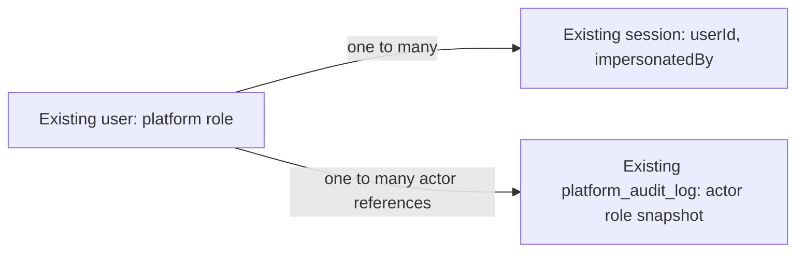

# Content Studio staff plane

| Field              | Value                                   |
| ------------------ | --------------------------------------- |
| **Status**         | draft                                   |
| **Issue**          | none                                    |
| **Spec PR**        | none                                    |
| **Implementation** | none                                    |
| **Plan**           | 13-S1 (docs/plans/13-content-studio.md) |

## TLDR

Plan stage **13-S1 in `docs/plans/13-content-studio.md`** gives editorial staff a deployment-wide Studio separate from workspace administration. This proposal describes the remaining work against `develop` commit `e6af560e9e97edecc51d860dc7d5da1d765aa1be`: retain the existing authentication, account console and audit mechanisms, and add editorial permissions, a workspace-independent Studio shell, a staff directory and operator history. This is design only; independent product, architecture and security review must approve the exact design revision before unattended slicing or implementation.

## Problem, scope and current evidence

Editorial staff need controlled access to the operator plane without membership in a customer's workspace or authority to manage customer accounts. Workspace `owner`/`admin` standing must never grant this access. This stage makes staff access and its administration usable before the content editor arrives.

The historical plan describes several modules as absent which now exist. Evidence below is from the base commit above; it is source inspection, not a claim that this spec tested runtime behavior.

| Plan statement                            | Current implementation                                                                                                          | Remaining design                                                                          |
| ----------------------------------------- | ------------------------------------------------------------------------------------------------------------------------------- | ----------------------------------------------------------------------------------------- |
| Install admin plugin and role columns     | `auth/admin-options.ts`, `auth/index.ts`, `db/auth-schema.ts`, `lib/auth/client.ts` already configure them.                     | Extend the role/permission contract; keep one plugin registration.                        |
| New access controller and staff assertion | `auth/access.ts` defines `admin`, `curator`, `user`; `auth/guard.ts` owns the pure `requirePermission` predicate.               | Add editorial roles; refresh authority before invoking the same predicate.                |
| New staff repository                      | `fns/console/users.ts`, `sessions.ts`, `adapter-reads.ts`, `context.ts` implement guarded account operations using Better Auth. | Reuse these capabilities; no `repos/staff.ts` or new raw auth SQL.                        |
| New platform audit writer/table           | `catalog/audit.ts` owns append, entity history and 400-day retention; `db/schema.ts` defines `platformAuditLog`.                | Add bounded staff-history reads to that owner.                                            |
| Staff shell/team/people                   | `/console` already manages deployment accounts; `/admin` remains workspace administration; `/studio` is absent.                 | Add the separate Studio shell and directory, with links to the existing account console.  |
| Published-surface summary                 | Content Studio stores and collections are not implemented.                                                                      | Show an explicit unavailable state until 13-S2 provides real counts; never invent counts. |

Stage IDs are not unique across plans: the Community Gallery 13-S1 publication pipeline is unrelated. No Gallery, publishing pipeline, CMS editor, translations, assets, announcement delivery, legal acceptance, impersonation feature, account-security activation, MCP capability or production rollout is included here. No stage depends on this spec implementing a later stage's tables. No new service, package, binding, secret, spend or production access is required.

## Contract reconciliation and owner modules

The current authorities are `docs/SPEC.md` §§5–9, `docs/ACCESS.md`, ADRs 0002/0016/0049 and `BACKWARD_COMPATIBILITY.md`. The plan's five-role vocabulary, raw deployment repositories, cookie-cache explanation and transactional-sounding audit assertions are historical input, not permission to override those contracts.

| Concept                                | Owner and integration                                                                                                                                                                                                               |
| -------------------------------------- | ----------------------------------------------------------------------------------------------------------------------------------------------------------------------------------------------------------------------------------- |
| Role dictionary and permission matrix  | Extend `src/server/auth/access.ts` and the same-commit matrix in `docs/ACCESS.md`. Preserve the existing resources and roles.                                                                                                       |
| Primary staff authority admission      | New binding-free helper `src/server/fns/console/staff-authority.ts`; adapter reads in the existing `adapter-reads.ts`; binding wiring in `bindings.ts`. Reuse it from `openConsoleCall` and new `src/server/fns/studio/context.ts`. |
| Account mutations and sessions         | Existing `src/server/fns/console/users.ts` and `sessions.ts`; no duplicated role-grant, ban or revocation implementation.                                                                                                           |
| Global staff history                   | Existing `src/server/catalog/audit.ts`; account identity comes from Better Auth's adapter, never a join to tenant content.                                                                                                          |
| Studio shell and route transport       | `src/routes/studio/{route,index,team,people}.tsx`, `-server/staff.ts`, `-ui/shell.tsx`. Not nested under `_app`.                                                                                                                    |
| Staff directory/overview orchestration | New binding-free `src/server/fns/studio/staff.ts`; small context/bindings modules own runtime dependencies.                                                                                                                         |
| Copy and presentational primitives     | Existing `console` catalogue namespace in every locale; existing `PageHeader`, `Card`, `Button`, `EmptyState`, `ErrorPanel`, list and dialog primitives. `components/ui` acquires no fetching or server imports.                    |

Do not add `repos/staff.ts`, `repos/platform-audit.ts`, a second audit log or a second authorization predicate. Global audit SQL stays inside the already-admitted catalog boundary. Auth identity access uses Better Auth's adapter, consistent with ADR 0002's clarification; do not expand provisioning, FU-3 or the closed account-security repository. `requirePermission` stays synchronous, binding-free and free of reads/writes.

The implementation must amend every affected statement in `docs/ACCESS.md`, `docs/SPEC.md`, `docs/ARCHITECTURE.md` and role-facing runbook sections together with the permission change. Preserve historical plan prose and explain its reconciliation here. No schema-contract or guard changes ship in this design-only PR.

## Authorization and role compatibility

Preserve `admin`, `curator`, `user`, `adminRoles: ['admin']`, the absence of `adminUserIds`, the disabled native admin HTTP paths and current impersonation veto. The historical `platform_admin` name is represented by existing `admin`; do not migrate or alias existing users to a new administrator name. Add `editor`, `publisher`, `legal_reviewer` to the one platform roles map. Membership roles remain unchanged.

The following action sets are proposed for subsequent Studio consumers; defining a permission is not implementing its action:

| Resource       | Actions                                             |
| -------------- | --------------------------------------------------- |
| `studio`       | `read`, `audit`                                     |
| `content`      | `read`, `create`, `update`, `publish`, `unpublish`  |
| `navigation`   | `read`, `update`, `publish`                         |
| `announcement` | `read`, `create`, `update`, `send`, `cancel`        |
| `media`        | `read`, `upload`, `update`, `delete`                |
| `legal`        | `read`, `review`, `publish`, `require-reacceptance` |
| `settings`     | `read`, `update`                                    |

| Role             | New Studio resources                                                            | Existing resources                                                                                             |
| ---------------- | ------------------------------------------------------------------------------- | -------------------------------------------------------------------------------------------------------------- |
| `admin`          | All new actions.                                                                | Exactly its existing matrix, including its existing limited support impersonation; never `impersonate-admins`. |
| `curator`        | None.                                                                           | Existing catalogue/pack/source/share permissions unchanged.                                                    |
| `user`           | None.                                                                           | None.                                                                                                          |
| `editor`         | `studio:read`; `content:read/create/update`; `media:read/upload`.               | None.                                                                                                          |
| `publisher`      | Editor actions plus `content:publish/unpublish` and all `announcement` actions. | None.                                                                                                          |
| `legal_reviewer` | `studio:read` and all `legal` actions.                                          | None.                                                                                                          |

Only `admin` can see Team, deployment account search or cross-account audit: Team/People require `user:list`, grants additionally `user:set-role`, ban/revoke retain their existing statements. Dashboard staff see their own role and available sections, not other people's audit or account counts. Grant/revoke uses the existing role setter and refuses self-targeting as today; it does not invent a second administrator bootstrap path. Existing `/console/users` can grant the new roles through the same setter.

Keep strongest-single-role resolution, not an accidental union. Preserve every pre-existing comma-joined role result. Extend precedence to `admin`, `curator`, `publisher`, `editor`, `legal_reviewer`, `user`; order is explicit because legacy resolution already selects one role. The supported UI writes exactly one role. Unknown, null, whitespace-padded or malformed values retain deny-by-default behavior. Multi-role editorial access is out of scope; tests cover the documented precedence rather than implying combined legal/editorial authority.

Adding roles must not make `/console` or its shell menu admit every role other than `user`. Audit `routes/_app/console/-server/access.ts`, `components/layout/session.ts`, role badges/selects, schemas, audit actor types, client/server role resolvers and permission drift tests. `/console` standing remains `admin` or `curator`; `/studio` standing is decided by `studio:read`. A workspace owner with platform `user` gets neither. Existing tenant repositories must not import Studio context or derive authority from platform roles.

## Fresh authority, sessions and tenant isolation

For each Studio server call and shared account-management call, resolve the existing authenticated session through the current auth/account-authority path first. From its server-resolved session/user identifiers, read the native session and user through Better Auth's adapter on the primary D1 path: session id/user binding, expiry and `impersonatedBy`; user id, role and banned state. No user-supplied actor, token, workspace or role selects that read. Check account-authority revision/enforcement exactly as the existing entry point does; this stage neither activates enforcement nor adds a weaker acceptance route.

Build the guard input from that fresh identity and call `requirePermission` before any projection or mutation. Missing, expired, mismatched, banned, impersonated, unreadable or revoked authority fails closed. Never fall back to the KV user-role snapshot after a read error. Use the same reader from the Studio context and `openConsoleCall`, so the Team screen cannot be bypassed through the legacy console RPCs. The permission predicate remains the sole matrix owner.

D1 freshness means the next admission check after demotion/ban/revocation observes the committed change despite a retained cookie or stale KV blob. It does not claim an interactive transaction spanning a Better Auth API call or retroactively cancel an already admitted request. Concurrent mutation semantics must be stated and tested at this admission point. Session-ending mutations retain the existing pre-mutation cache purge, account-authority hooks, room eviction and lost-response handling; a new Studio wrapper must not bypass them.

No `TenantScope` is created by Studio. A staff user with no organization can enter; a session's active workspace is irrelevant. No trips, workspace names, membership lists, payment details, session tokens, factors or account-security receipt data are returned. Primary reads use the existing adapter/primary binding conventions, without importing an interactive transaction API. Record primary-read counts/latency for the common console boundary change before implementation is accepted; no claim that the added reads are free.

## Data model, migrations and audit semantics

Reuse `user.role`, `user.banned`, `user.banReason`, `user.banExpires`, `session.impersonatedBy` and `platform_audit_log`. Existing user-role values are retained; there is no backfill or sign-up default change. `PLATFORM_ACTOR_ROLES` and runtime validators must accept the new role names without rewriting historical actor roles. At this base `actor_role` has a TypeScript vocabulary but no SQL role-value CHECK; verify that fact again before generating a migration.

No new entity is needed. If global history requires an index matching `(created_at, id)`, add that index only through `pnpm db:generate`, stage its generated output, and prove the old Worker works with the additive schema. Do not rebuild/drop auth or audit tables, tighten old-row constraints or hand-write migrations. The existing per-entity history and prune remain available. No new tenant quota or retention setting is introduced; retain the existing 400-day prune and account-erasure behavior.

The single writer remains `appendPlatformAudit`, called through the existing `recordConsoleAction` path for account operations. It records the actor/role at admission and bounded before/after state. Do not include credentials, proof material, tokens, search text or full user records. Reading/searching does not append mutation events. Future publish/send actions must use the same writer when their own stages are designed; no invented success events are emitted now.

**Audit is post-commit and best effort, not atomic with Better Auth.** `catalog/audit.ts` explicitly catches append failures and reports incidents. Preserve that contract: a successful operation attempts exactly one existing audit event, ordinary persistence succeeds once, and an append failure leaves an observable incident without a misleading rollback/failure response. Never replay a mutation merely to repair a missing audit row. A guaranteed durable audit/outbox for every plugin mutation would be a separate security-contract change and is not silently promised here. The directory shows “Not recorded” when grant provenance is absent or pruned; it must not attribute a grant to the account's creator or latest profile update.

## Server contracts and bounds

Every route server-function input is a `z.strictObject`, including `{}`. Use existing id/locale schemas and named exports. Functions return closed projections with validated timestamps and no spread of Better Auth output. Studio transport delegates account mutations to their single existing owner after fresh admission.

| Function                     | Input and authority                                                                                                               | Result                                                                                                                        |
| ---------------------------- | --------------------------------------------------------------------------------------------------------------------------------- | ----------------------------------------------------------------------------------------------------------------------------- |
| `loadStudioShell` GET        | `{}`; `studio:read`.                                                                                                              | Own resolved role and permitted navigation only.                                                                              |
| `loadStudioOverview` GET     | `{}`; `studio:read`.                                                                                                              | Collection-summary state `unavailable` before 13-S2; recent staff actions only for `studio:audit`.                            |
| `loadTeam` GET               | `{cursor?, limit?}`; `studio:read` plus `user:list`.                                                                              | Up to 50 staff accounts with id/name/email/current role; nullable grant actor/time derived from existing audit, `nextCursor`. |
| `grantRole` POST             | `{userId, role}`; `user:set-role` plus Studio standing. Role is exactly one of the six declared names.                            | Existing role-setter account projection, narrowed for Studio.                                                                 |
| `loadPeople` GET             | `{search, cursor?, limit?}`; `user:list` plus Studio standing. Search is email-only, trimmed length 3–254; limit 1–50 default 25. | id/name/email/role/banned only, plus `nextCursor`.                                                                            |
| `banAccount` POST            | Same target/reason/expiry input and limits as existing `banPlatformUser`; same permission and no self-target weakening.           | Existing sanitized mutation result.                                                                                           |
| `revokeAccountSessions` POST | Same target input as existing all-session revoke; `session:revoke`.                                                               | Existing sanitized result/partial-cleanup semantics.                                                                          |
| `loadOperatorHistory` GET    | `{cursor?, limit?}`; `studio:audit` plus Studio standing.                                                                         | Up to 50 rows: id/time/action/actor kind/id/role/entity type/id; no raw changes, IP or user agent.                            |

Directory cursors are strict versioned objects with a binary-ordered account id, size bounded to 512 characters serialized; account pages sort `id DESC` and use `id < cursor.id`. This is a stable directory order, not a claim that Better Auth's random ids are chronological. Audit history alone sorts `(createdAt DESC, id DESC)` with the matching strict tuple predicate inside `catalog/audit.ts`. Both use `limit + 1`, no offset scan and no locale collation for IDs. A cursor never carries authorization, and changing the filter resets it.

The pinned Drizzle adapter's `convertWhereClause` supports an AND group combined with an OR group, and `findMany` supports one sort field. Use those existing operations: an AND id bound plus OR `role contains` candidates for the four Studio-admitted roles; after reading at most `limit + 1` candidate rows, canonical `resolvePlatformRole` filters the first `limit` candidates. This preserves recognized comma-role strings and excludes substring false positives or stronger non-Studio roles. There is no full-account walk in one call. The extra candidate determines continuation; the next cursor is the last inspected candidate, excluding that lookahead. A short or empty filtered page with continuation is not global exhaustion: show an explicit continuation state and a next-page action, never a false “no staff exist” message. Repeated explicit pages eventually cover the unchanged candidate set.

People search uses the adapter's bounded email `contains` prefilter and verifies literal, case-normalized substring inclusion before projecting results, so SQL LIKE wildcards in valid email text cannot widen the displayed match. Apply the same candidate-page/continuation semantics when prefiltering yields false positives. Search is 3–254 characters because this new adapter read does not delegate to the console's 120-character `list-users` endpoint. No adapter extension, raw SQL or new data-access exception is required. Tests must drive the actual pinned adapter's filters/single-field sort and cover wildcard text, comma roles, false-positive-only pages and end-of-scan behavior.
Directory provenance must use bounded queries: fetch only the current page's relevant role-change history, cap each historical walk and return “Not recorded” when no reliable current-grant match is found. No N+1 unbounded scans, email-only identity joins, or invented audit entries. Primary role state is authoritative; audit history is explanatory. Audit history stays inside `catalog/audit.ts` with a global keyset read; account identity joins are unnecessary for its projection.

Preserve all existing console inputs/outputs and enum meanings for old clients. The new Studio email search does not change the existing console search bound. A failed list must be an error, never a false empty result: pinned `admin/routes.mjs` catches `listUsers` failures and returns an empty array, so use a tested bounded adapter read for new directory pages rather than treating that endpoint as a reliable error boundary.

## UI/UX and visual change expected

New routes `/studio`, `/studio/team`, `/studio/people` use SSR and existing primitives. The layout has its own shell and locale/session resolution, without `_app`'s workspace guard/provisioning. Reuse the existing session normalization and locale catalogue loader; render no placeholder workspace. Staff sign-in remains the existing login flow; no credential form is duplicated.

Unauthorized Studio route navigation, including anonymous, banned or impersonated sessions, returns the existing generic 404 and no staff payload. Direct RPCs still fail at the server boundary; hiding a route is no authorization. SSR denial must precede child data loading and serialization. Do not change `/console`'s existing dashboard redirect behavior. Authenticated staff with no workspace reach Studio; loss of an editorial role on the next navigation ends at the same 404.

The dashboard names the signed-in staff role, shows permitted sections and the unavailable content-summary state. For admins it includes a recent operator-history list with “Load more”. Team lists staff and grant provenance with an explicit “Not recorded” fallback, and a role-change confirmation naming the target and both roles. People offers email search, paged results, ban and revoke-session confirmations, and a link to the existing full console account detail. Do not duplicate its password, deletion, billing or impersonation controls. Non-admin staff have no Team/People/history nav entry or payload.

Every list has row-shaped loading skeletons, a useful empty state and an `ErrorPanel` with retry. Before three search characters, show guidance and make no directory request. A filtered candidate page that has continuation uses the explicit partial-page state instead of the global empty state. Search result pages are invalidated when the query changes. Cancelled or superseded responses cannot populate a newer query. Mutation controls disable while pending; errors preserve inputs; success refreshes data from the server. A lost response triggers a readback and clear “Check current status before trying again” guidance, never an automatic mutation retry.

Visual acceptance covers 360, 768, 1440 and 2560px in both themes, with a stacked list at 360px; 4px-grid tokens and logical properties for RTL; no unscoped layout shift after paint. Keyboard users can operate navigation, role selects, paged lists and confirmation dialogs; focus enters the dialog, returns to its trigger, and moves to a surviving list landmark if the row disappears. Accessible names identify the target account, errors are associated with inputs and asynchronous results have a polite status region. Verify WCAG 2.2 AA contrast, visible/unobscured focus, 24px minimum target size or spacing exception, zoom/reflow, reduced-motion and screen-reader announcements. Motion uses existing 150–260ms tokens with reduced-motion honored.

The design is standard directory/confirmation UI; no accepted detailed prototype exists. Current-app screenshots and rendered proposal evidence are absent from this draft: the assignment forbids copied secrets and the heavy/browser interval belongs to Delivery. Text and source inspection do not establish visual QA. Supply that evidence during coordinated implementation review; this draft grants no QA sign-off.

## Copy

Use the existing `console` namespace; reuse existing shared confirmation, retry, role and account strings wherever their meaning matches. The following are new English keys/text; all 23 locales, including interpolation parity and Arabic RTL, land together with implementation. New role badges need the three new role labels in existing console controls too.

| Key                                  | English text                                          |
| ------------------------------------ | ----------------------------------------------------- |
| `console.studio.title`               | Content Studio                                        |
| `console.studio.description`         | Manage editorial access and review operator activity. |
| `console.studio.nav.overview`        | Overview                                              |
| `console.studio.nav.team`            | Studio team                                           |
| `console.studio.nav.people`          | People                                                |
| `console.studio.content.unavailable` | Content publishing is not available yet.              |
| `console.studio.team.empty`          | No editorial staff have been assigned yet.            |
| `console.studio.team.grantedBy`      | Granted by                                            |
| `console.studio.team.grantedAt`      | Granted on                                            |
| `console.studio.team.notRecorded`    | Not recorded                                          |
| `console.studio.team.changeRole`     | Change role for {name}                                |
| `console.studio.team.confirmRole`    | Change {name} from {fromRole} to {toRole}?            |
| `console.studio.people.searchLabel`  | Search by email                                       |
| `console.studio.people.searchHint`   | Enter at least 3 characters of an email address.      |
| `console.studio.people.empty`        | No account matches that email search.                 |
| `console.studio.people.openAccount`  | Open account for {name}                               |
| `console.studio.history.title`       | Recent operator activity                              |
| `console.studio.history.empty`       | No recorded operator actions in this period.          |
| `console.studio.history.more`        | Load more activity                                    |
| `console.studio.status.updated`      | Account updated.                                      |
| `console.studio.status.uncertain`    | Check the current account status before trying again. |
| `console.studio.role.editor`         | Editor                                                |
| `console.studio.role.publisher`      | Publisher                                             |
| `console.studio.role.legalReviewer`  | Legal reviewer                                        |

User-facing audit action labels reuse existing localized labels; never print internal dotted action names as the only description. Any missing existing label is added in the same 23-locale implementation change. Dates, counts and account text use existing safe formatting and wrapping rules; role ids and enum values are not translated in transport/storage.

## Failure paths, compatibility and rollout

- Primary/adapter/session-authority failure: no payload or mutation, generic localized failure with retry; no KV-authority fallback.
- Role removed while a tab is open: its next fresh admission fails even if the UI still shows a control. Explicitly test stale cookies and retained KV blobs.
- Native admin HTTP probe: existing disabled paths stay 404, including paths an editorial account attempts directly. `adminUserIds` remains absent and plugin initialization still validates the complete roles map.
- Mutation or purge failure before commit: retain existing refusal and safe retry semantics. Committed mutation plus later audit/cache-cleanup failure: preserve existing incident/cleanup result, never claim rollback or blindly repeat the operation.
- Missing or expired audit provenance: “Not recorded”; raw audit failures show an error, not an empty successful history. Retention remains 400 days and audit is not an eternal staff-grant ledger.
- Deleted account/history actor: render stable bounded identifiers safely; do not resurrect erased identity by joining historical PII. All directory results escape account text.
- Mixed deploy: deploy any additive index first, then compatible role-aware readers, audit validators and UI. **Do not assign new roles until every serving Worker can parse and preserve them.** Retain old role names and all old RPC shapes. Roll back grants to old roles and verify primary state before rolling back to a Worker unaware of editorial roles; security-authority cutover restrictions in ADR 0049 still dominate rollback.
- No production activation is performed by this spec, and no agent promotes `develop` to `main`. Initial administrator recovery remains the existing human-owned runbook; do not seed a privileged user or new secret.

## Acceptance and validation

Implementation is accepted only when the following have executable evidence:

1. Legacy `admin`/`curator`/`user` permission matrices, mixed-role precedence, disabled native paths, absent `adminUserIds` and account-authority routes all retain their prior behavior. Every new role has the exact positive/negative matrix above, including no account/session powers for editorial roles and no new admin-on-admin impersonation.
2. A workspace owner/admin with platform `user` is refused by every Studio read/mutation; an editorial user cannot search people, grant roles, ban/revoke or read cross-account history. Direct RPCs and SSR both prove no staff data in denied responses.
3. A staff account without any membership loads Studio; one in workspace A sees no workspace B content or identity beyond the explicit deployment-account projection authorized for admins. Studio's transitive graph reaches no tenant scope factory/repository or provisioning path.
4. Demote, ban, expire, revoke or impersonate an operator while retaining stale KV/cookies; the next fresh admission refuses. Inject adapter errors and missing native session/user rows. Race admission versus revocation to pin the stated admission semantics and preserve account-security revision checks.
5. Role grants, bans and revocations execute their actual shared handlers and installed Better Auth integration; success produces the existing action once under ordinary audit persistence. Force audit failure after commit and verify the action remains committed with an incident and no duplicate retry. Existing purge/eviction/last-owner safeguards retain their tests.
6. Audit keyset reads with equal timestamps and binary-random ids, and directory reads with random account ids, have no repeated/omitted rows on an unchanged dataset. Search/role filters cannot mix pages; malformed/oversized cursors fail Zod. Instrument statement/page limits, exercise adapter errors and prove no unbounded scan or credential projection. Audit readers do not write audit rows.
7. Browser evidence proves no-membership access, owner-only refusal, grant then demote with stale tab, all empty/loading/error/confirmation states, query-response races and uncertain mutation readback. Check the viewport/theme/accessibility matrix above; zero application console errors/warnings. Use ADR 0016 journeys and blind A/B capture for implemented surfaces, without claiming historical pixel gates ran.
8. Run the configured ordered gate from `.ai/agentic.config.json` using `node scripts/ci/validation.mjs`: typecheck, lint, all server/tooling/ui Vitest projects, generated check, build. Stage generated routes/migrations/spec index first. Node suites inject bindings at a binding-free seam; UI suites mock Worker-reaching imports. Independently review the final implementation diff and security/tenancy tests before completion.

Suggested proof owners: `auth/__tests__/access.test.ts`, `guard.test.ts`, `admin-options.test.ts`; `fns/console/__tests__/adapter-reads.test.ts`, `console.test.ts`, `isolation.test.ts`; new `fns/studio/__tests__/staff.test.ts`; `catalog/__tests__/audit.test.ts`, `isolation.test.ts`; route UI suites and a focused Studio journey. Use real SQLite and the real installed Better Auth harness for mutations; mocks alone cannot prove D1 freshness or plugin behavior. Record hot-path primary-read counts and latency with existing console calls as the baseline.

This documentation PR must run the spec-registry tests, regenerate/stage its index and check generated artifacts. The full configured gate/native CI still applies before merge; focused docs checks are not evidence that the full application gate passed.

## Phasing and implementation plan

Three tracer-bullet tickets fit the eight-ticket ceiling. Each owns its contract amendments, tests, copy and complete UI states; do not ship a schema-only or authorization-only layer awaiting another ticket to become usable.

1. **Editorial admission and usable Studio home.** Extend the existing access map without changing legacy cells; add the fresh shared platform admission reader and Studio context; audit all role consumers and preserve `/console` standing; mount the workspace-independent `/studio` home with its real unavailable state. Update access/spec/runbook contracts, new role labels in all locales and inherited console/security tests. Verify staff-without-workspace access, denied direct RPC/SSR and next-request demotion. No new roles are assigned operationally until the mixed-deploy gate is satisfied.
2. **Complete staff directory and account actions.** Add Team and People with bounded adapter pagination, provenance fallback, role changes and shared ban/revoke actions; link to existing account detail. Include localized confirmations, loading/empty/error states, concurrent search protection, lost-response readback and all permission/projection tests. No duplicate account mutation or native admin HTTP transport.
3. **Operator activity discovery.** Extend the existing audit owner with the bounded global keyset projection and an additive generated index only if the query requires it; mount the admin-only dashboard history. Include retention/erasure behavior, no-PII projection tests, tied timestamp pagination and audit-failure evidence. Run the whole-project gate and focused browser/accessibility matrix, then independent final diff review.

Dependencies: existing operator substrate is on the base commit. 13-S2 consumes these permissions/context later and supplies real collection-summary counts; it is not required to make these three slices useful. The directory uses the pinned adapter's single-id ordering and bounded candidate filtering; it requires no open-ended adapter or SQL exception.

## Research and review limits

The official [Better Auth admin documentation](https://www.better-auth.com/docs/plugins/admin) describes custom access-control roles and native administrative APIs. This design uses the already-installed plugin and application guard rather than exposing a second privileged HTTP surface. The installed `better-auth@1.7.1` files `admin.mjs`, `has-permission.mjs` and `routes.mjs` were inspected for role-map validation, id-list bypass and swallowed list errors; installed behavior is the authority for those version-specific claims.

[Payload's access-control documentation](https://payloadcms.com/docs/access-control/overview) was consulted as an open-source CMS comparison. Its separation of access decisions and admin presentation supports explicit role-dependent surfaces; this proposal keeps the repository's single predicate rather than importing another CMS, role store or UI framework. These are design comparisons, not evidence of user demand or implementation verification. Both public pages were fetched on 2026-11-09.

Independent verdicts are pending. The author has not reviewed or approved this design. Current-app screenshots, full application gate and production behavior are not established by this document.

## Resolved assumptions (autonomous defaults)

The following are **proposed author defaults grounded in current contracts**, pending independent specialist adjudication. No row is represented as a specialist verdict; the exact review commit and final product/architecture/security verdicts must be recorded before this spec becomes ready.

| #   | Question                          | Applied default                                                                                                  | Why                                                                                                                 |
| --- | --------------------------------- | ---------------------------------------------------------------------------------------------------------------- | ------------------------------------------------------------------------------------------------------------------- |
| 1   | Existing administrator vocabulary | Keep `admin` and `curator`; add editorial roles, no `platform_admin` rename.                                     | Current `auth/access.ts`, `admin-options.ts` and ACCESS matrix are compatibility contracts.                         |
| 2   | Staff data boundary               | Reuse auth adapter and existing console/catalog owners.                                                          | SPEC §6 and ADR 0002 close the SQL exceptions; the plan predates those modules.                                     |
| 3   | Role freshness                    | Fresh primary admission composed with `requirePermission`, shared by Studio and account-management entry points. | The plan requires next-request revocation; the predicate stays pure and KV delivery cannot decide staff authority.  |
| 4   | Audit guarantee                   | Existing post-commit best-effort append, bounded provenance fallback.                                            | `catalog/audit.ts` and ACCESS §4.3 do not offer plugin/audit transactionality.                                      |
| 5   | Standalone shell and summary      | Workspace-independent Studio; no fabricated collection counts.                                                   | `_app` has tenant provisioning; content stores are future 13-S2 work.                                               |
| 6   | Independent review                | Pending product, architecture and security/tenancy verdicts on the exact commit; draft until supplied.           | No self-approval or agent creation is authorized. An existing independent reviewer must judge material commitments. |
